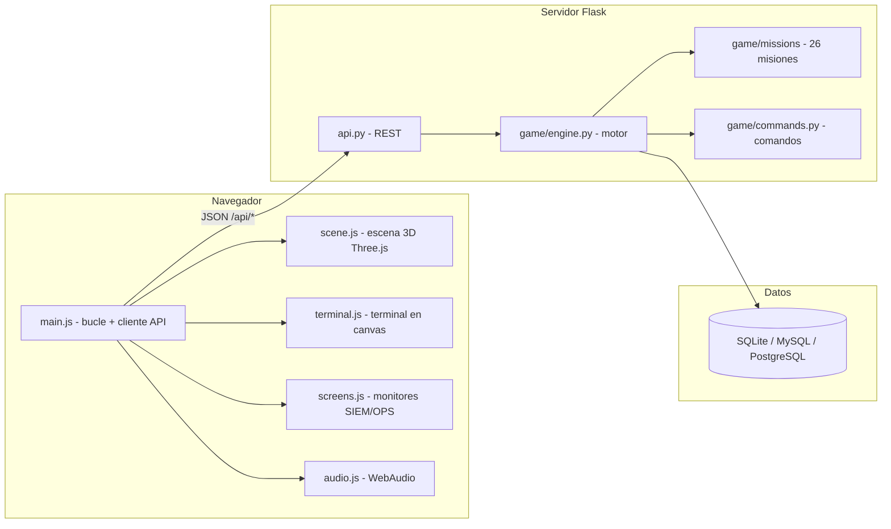
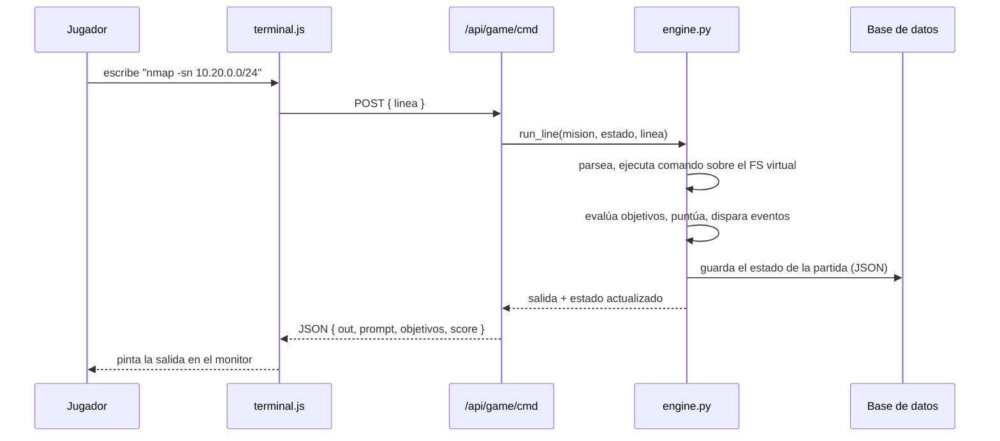
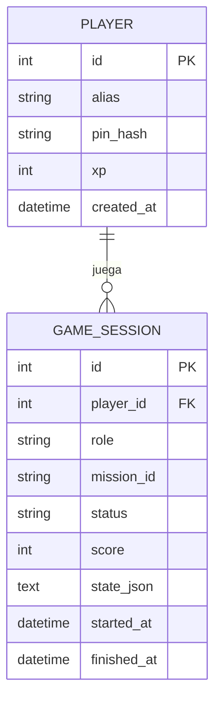

# CyberAL — Juego 3D para aprender ciberseguridad

> Un laboratorio de hacking ético en el navegador. Te sientas frente a tres monitores en un cuarto oscuro con lluvia en la ventana, escribes en una terminal real y resuelves misiones por rol. Todo ocurre en **entornos simulados**: ningún comando toca redes reales.

<p align="center">
  
  
  
  
  
  
</p>

---

## Tabla de contenido

- [¿Qué es?](#qué-es)
- [Características](#características)
- [Roles y misiones](#roles-y-misiones)
- [Stack tecnológico](#stack-tecnológico)
- [Arquitectura](#arquitectura)
- [Flujo del sistema](#flujo-del-sistema)
- [Modelo de datos](#modelo-de-datos)
- [Estructura del proyecto](#estructura-del-proyecto)
- [Puesta en marcha](#puesta-en-marcha)
- [Despliegue en Render](#despliegue-en-render)
- [Pruebas](#pruebas)
- [CI/CD](#cicd)
- [Rendimiento](#rendimiento)
- [Cómo agregar una misión](#cómo-agregar-una-misión)
- [Sprints](#sprints)
- [Roadmap](#roadmap)
- [Licencia](#licencia)

---

## ¿Qué es?

CyberAL enseña ciberseguridad **jugando**. En lugar de leer teoría, el jugador opera una terminal simulada dentro de una escena 3D y avanza por misiones que van de "nunca he abierto una terminal" hasta "estoy respondiendo a un ransomware en vivo". Cada misión se juega sobre un **sistema de archivos virtual** y comandos imitados (nmap, ssh, curl, macchanger, exiftool…), de modo que es seguro, reproducible y no requiere laboratorios externos.

El objetivo es doble: que sea **didáctico** (lecciones, pistas y preguntas integradas) y que **se sienta como un juego** (escena 3D con Three.js, terminal estilo oh-my-posh, música y efectos).

---

## Características

- **5 roles** con un camino de aprendizaje propio: Red Team, Blue Team/SOC, Pentester, QA/Security Tester y Privacidad/OPSEC.
- **26 misiones** (un tutorial común + 5 niveles por rol), de muy fácil a muy difícil.
- **Terminal real** dibujada en canvas: prompt powerline estilo oh-my-posh, historial, autocompletado con TAB, tuberías (`|`), `neofetch`/`fastfetch` y decenas de comandos simulados.
- **Escena 3D** (Three.js/WebGL): cuarto con PBR, sombras, lluvia, neón, bloom y audio ambiente.
- **Motor de misiones declarativo**: cada nivel define objetivos, archivos, eventos con tiempo límite, medidores de presión y mini-lecciones (`aprende <tema>`).
- **Agnóstico de base de datos**: SQLite en desarrollo, MySQL en Docker local, PostgreSQL en producción.
- **Calidad automática**: mide los FPS y ajusta el render para correr fluido en cualquier GPU, incluidas integradas.
- **Listo para la nube**: `Dockerfile`, `docker-compose.yml`, `render.yaml` (Blueprint) y workflows de CI/CD.

---

## Roles y misiones

Hay un **nivel 0 (tutorial)** común y **5 niveles por rol**, del 1 (muy fácil) al 5 (muy difícil). Se juegan en el orden que quieras desde la pantalla de selección; los primeros son práctica sin presión y los últimos tienen medidor y contrarreloj.

| Nivel | Red Team | Blue Team / SOC | Pentester | QA / Security | Privacidad / OPSEC |
|---|---|---|---|---|---|
| 1 | La llave olvidada | El correo del lunes | Primer vistazo | Tu primer caso de prueba | ¿Quién soy en la red? |
| 2 | Contraseñas de papel | Una cuenta de más | Lo que dicen las cabeceras | Valores que no deberían pasar | Cambia tu MAC |
| 3 | Mapa de la red | Lo que dicen los logs | Archivos olvidados | La cuenta de alguien más | Oculta tu IP |
| 4 | Operación Espejo Roto | Turno Nocturno | Auditoría TiendaVolt | Release 2.4 de PagaYa | Limpia tus rastros |
| 5 | Salto lateral | Hora cero: ransomware | La cadena completa | Dos clics a la vez | Cadena de anonimato |

Cada misión guiada incluye `objetivos`, `pista` (cuesta puntos), `aprende <tema>` (mini-lecciones) y preguntas que se contestan con `responder <texto>`.

---

## Stack tecnológico

| Capa | Tecnología |
|---|---|
| Backend | Python 3.12, Flask 3.1, Flask-SQLAlchemy |
| Base de datos | SQLAlchemy sobre SQLite / MySQL (PyMySQL) / PostgreSQL (psycopg2) |
| Servidor | Gunicorn (producción), servidor Flask (desarrollo) |
| Frontend | JavaScript (ES Modules), Three.js r187 (WebGL), Canvas 2D, Web Audio API |
| Empaquetado | Docker, docker-compose |
| CI/CD | GitHub Actions |
| Despliegue | Render (Blueprint `render.yaml`) |

El frontend no usa framework: es JS modular servido por Flask, con Three.js incluido en `vendor/` para funcionar sin CDN.

---

## Arquitectura



El cliente solo pinta y manda comandos; **toda la lógica del juego vive en el servidor** (el motor, el sistema de archivos virtual y el estado de la partida). Esto hace trampas-resistente el juego y mantiene el frontend ligero.

---

## Flujo del sistema

Cómo se ejecuta un comando de una misión:



El estado completo de cada partida se serializa a JSON y se guarda por sesión, así el jugador puede retomar donde se quedó.

---

## Modelo de datos



Las tablas se crean solas al arrancar (`db.create_all()`); no hay scripts SQL que mantener.

---

## Estructura del proyecto

```
cyberal/
├─ app/
│  ├─ __init__.py          # fábrica de la app Flask
│  ├─ api.py               # endpoints REST (auth, roles, start, cmd, tick, leaderboard)
│  ├─ config.py            # configuración y normalización de DATABASE_URL
│  ├─ extensions.py        # instancia de SQLAlchemy
│  ├─ models.py            # Player y GameSession
│  ├─ game/
│  │  ├─ engine.py         # motor: FS virtual, eventos, puntuación
│  │  ├─ commands.py       # comandos genéricos (ls, cat, grep, nmap, ssh…)
│  │  ├─ topics.py         # lecciones de "aprende"
│  │  └─ missions/         # una clase por misión (26 en total)
│  ├─ static/
│  │  ├─ js/               # scene, terminal, screens, audio, main
│  │  ├─ css/              # estilos de la interfaz
│  │  └─ vendor/three/     # Three.js r187 (sin CDN)
│  └─ templates/index.html
├─ tests/                  # pytest: API y recorrido de las 26 misiones
├─ Dockerfile              # imagen de producción (gunicorn)
├─ docker-compose.yml      # web + MySQL para desarrollo local
├─ render.yaml             # Blueprint de Render (web + Postgres gratis)
└─ .github/workflows/      # ci.yml y deploy.yml
```

---

## Puesta en marcha

### Opción A — Docker (web + MySQL)

```bash
cp .env.example .env   # define SECRET_KEY y contraseñas
docker compose up -d --build
# abre http://localhost:5000
```

### Opción B — Desarrollo local sin Docker (SQLite)

```bash
pip install -r requirements.txt
python run_dev.py      # http://localhost:5000
```

Añade `?debug` a la URL para ver el contador de FPS y el nivel de calidad.

---

## Despliegue en Render

La app es agnóstica de base de datos, así que en producción usa **PostgreSQL** (Render no ofrece MySQL administrado).

1. Sube el repositorio a GitHub.
2. En Render: **New → Blueprint** y selecciona el repo. El `render.yaml` crea una base **Postgres gratis** y el **servicio web** en Docker, y conecta `DATABASE_URL` automáticamente.
3. Listo: las tablas se crean al arrancar.

La app convierte sola el `postgres://` que entrega Render a `postgresql+psycopg2://`. Avisos del plan gratis: el servicio web se duerme tras 15 min de inactividad (arranca en ~1 min) y la base Postgres gratis caduca a los 30 días.

---

## Pruebas

```bash
pytest -q
```

La suite valida los endpoints de la API y hace un **recorrido completo de las 26 misiones** (de principio a fin) para garantizar que todas se pueden terminar.

---

## CI/CD

GitHub Actions en `.github/workflows/`:

- **`ci.yml`** — en cada Pull Request a `main`/`dev` y en push a `dev`: corre la suite de pruebas (`pytest`) y valida que la imagen de Docker compile.
- **`deploy.yml`** — en push a `main` (o manual): compila la imagen y dispara el despliegue en Render vía webhook.

Para el deploy, define en GitHub el secret **`RENDER_DEPLOY_HOOK_URL`** (lo obtienes en Render → tu servicio → Settings → Deploy Hook).

---

## Rendimiento

El juego corre fluido incluso en GPUs integradas gracias a varias optimizaciones:

- **Calidad automática** (alto / medio / bajo): mide los FPS y ajusta solo la escala de resolución, el bloom, la lluvia y las sombras.
- **Resolución completa al enfocar** un monitor (texto nítido donde importa) y escalada al navegar el cuarto.
- **Instancing** del teclado, **sombras congeladas** (escena estática), **bloom a media resolución** y **antialias desactivado** (MSAA es lento en GPUs Intel).
- **Terminal en canvas** con fondo cacheado y sin `shadowBlur` por carácter.

---

## Cómo agregar una misión

Crea una clase en `app/game/missions/` que herede de `Mission` (o de `GuidedMission` para niveles guiados), define su `role`, su `level` (0 tutorial … 5 muy difícil), sus `hosts` (archivos y puertos), `objectives`, `events` y los comandos que necesite; luego regístrala en `missions/__init__.py`. El motor se encarga del resto (prompt, puntuación, pistas, estado).

> Usa estas técnicas solo en sistemas propios o con autorización por escrito.

---

## Sprints

El proyecto se construyó por incrementos:

- **Sprint 1 — Núcleo jugable.** Motor con sistema de archivos virtual, terminal en canvas, parser de comandos con tuberías, escena 3D y las primeras misiones de los 4 roles base.
- **Sprint 2 — Progresión.** Tutorial común y 5 niveles por rol (de muy fácil a muy difícil), con pantalla de selección de niveles y seguimiento de progreso.
- **Sprint 3 — Pulido y rendimiento.** Prompt oh-my-posh, `neofetch`, audio y una pasada de optimización (calidad automática, instancing, bloom, nitidez del texto) para correr en GPUs modestas.
- **Sprint 4 — Rol de Privacidad/OPSEC.** Camino de higiene digital ética: huella de red, MAC, ocultar IP, metadatos y cadena de anonimato.
- **Sprint 5 — Nube y CI/CD.** Base agnóstica (SQLite/MySQL/Postgres), Blueprint de Render y workflows de GitHub Actions.

---

## Roadmap

- Sistema de progresión con XP, rangos e insignias.
- Mapa de campaña / árbol de habilidades.
- Nuevos roles: Forense/DFIR, OSINT, Criptografía.
- Terminal HTML superpuesta al enfocar (texto vectorial, escritura instantánea).
- Modos de rejugabilidad: contrarreloj, sin pistas, reto diario, sandbox CTF.

---

## Licencia

MIT. Material educativo de ciberseguridad ética; úsalo solo en sistemas propios o con autorización.
